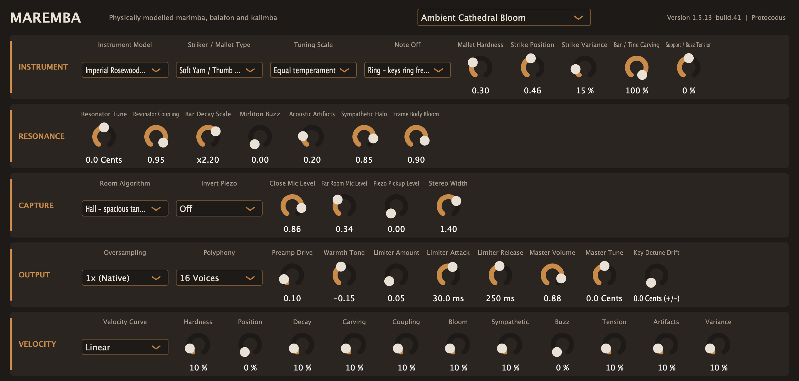

# Maremba

Maremba is a physically modelled mallet-percussion instrument by Protocodus:
a concert rosewood marimba, a Guatemalan padauk marimba, a West African balafon
and a 17-key box kalimba, played through modelled close microphones, a room and
a contact pickup. It runs as a VST3, CLAP and Standalone plug-in on macOS,
Windows and Linux, plus an Audio Unit on macOS, and as a Reason Rack Extension,
both built from the JUCE-free C++17 engine in `Source/DSP/`.



## Audio demos

Eight of the 20 factory presets, each showing a different side of the
instrument, rendered by every main build from `Docs/audio/midi/` through the
shipping engine.

<!-- audio-demos-begin -->

| # | Preset | Demo | Length | Peak |
| --- | --- | --- | --- | --- |
| 1 | Ambient Cathedral Bloom | [01-ambient-cathedral-bloom.wav](Docs/audio/01-ambient-cathedral-bloom.wav) | 12.0 s | -13.6 dBFS |
| 2 | Concert Grand Rosewood | [02-concert-grand-rosewood.wav](Docs/audio/02-concert-grand-rosewood.wav) | 12.0 s | -8.5 dBFS |
| 4 | Hard Acrylic Virtuoso | [04-hard-acrylic-virtuoso.wav](Docs/audio/04-hard-acrylic-virtuoso.wav) | 11.5 s | -4.9 dBFS |
| 6 | Rosewood Roll Chorale | [06-rosewood-roll-chorale.wav](Docs/audio/06-rosewood-roll-chorale.wav) | 11.4 s | -10.2 dBFS |
| 9 | Guatemalan Charleo | [09-guatemalan-charleo.wav](Docs/audio/09-guatemalan-charleo.wav) | 11.4 s | -5.1 dBFS |
| 12 | Birifor Gyil Buzz | [12-birifor-gyil-buzz.wav](Docs/audio/12-birifor-gyil-buzz.wav) | 11.8 s | -5.9 dBFS |
| 13 | Chopi Timbila Ensemble | [13-chopi-timbila-ensemble.wav](Docs/audio/13-chopi-timbila-ensemble.wav) | 11.7 s | -7.5 dBFS |
| 19 | Kalimba Pick Sparkle | [19-kalimba-pick-sparkle.wav](Docs/audio/19-kalimba-pick-sparkle.wav) | 11.4 s | -8.0 dBFS |

<!-- audio-demos-end -->

## Version history

### 1.5.13 — 2026-10-31 — Direct Piezo Mallet back at its 1.5.11 Volume

1.5.12's +0.46 dB pushed Direct Piezo Mallet's forte two-note strikes past the
output guard's 2 dB energy-loss bound, so its Volume returns to 1.5.11's. It
stays about 0.4 dB quieter than before 1.5.11.

### 1.5.12 — 2026-10-31 — Direct Piezo Mallet re-levelled

Direct Piezo Mallet's Volume rises 0.46 dB, back to the loudness it had before
1.5.11's cord damping made its film pickup quieter.

### 1.5.11 — 2026-10-31 — longer-ringing rosewood, quicker bass overtones

Measured key by key against the Iowa MIS 2012 concert marimba (cord, yarn and
rubber at ff, every key C2–C5), on the rosewood marimba only:

- The fundamental rings longer. Each tube takes less of its bar's energy, so a
  note's sustain moves from a median 0.87 to 0.96 of the recordings'. The
  sympathetic bars ring longer with it.
- The cords now damp each bar mode by how much it moves over their felt. The
  fundamental, whose nodes the cords sit on, keeps its ring; the two-octave
  and higher overtones die sooner (median 1.33 → 1.15 and 1.24 → 1.08 of the
  recordings' decay), so low notes lose their lingering overtone hum.
- Direct Piezo Mallet and Hard Acrylic Virtuoso, which carry those overtones
  most, sit about 0.4 dB quieter.

### 1.5.10 — 2026-10-30 — forte strokes stay on centre

- Forte strokes land where Position says. Thirteen bar presets no longer move
  the mallet off centre with velocity (their Position VEL is 0%), so a forte
  stroke keeps the centre's full fundamental: its two-octave overtone drops
  8–12 dB at G3–C5, toward the Iowa MIS 2012 concert marimba's centre
  strokes. Hard Acrylic Virtuoso, Direct Piezo Mallet, Chiapas Folk Fiesta,
  Equipentatonic Log Keys and the Kalimbas keep it. Rosewood Roll Chorale and
  Mayan Dance Padauk, 0.6 and 0.4 dB louder on centre, are trimmed back. The
  engine is unchanged.

### 1.5.9 — 2026-10-30 — three presets re-levelled

- Three presets are re-levelled after 1.5.8's brighter attacks: Rosewood
  Roll Chorale is 0.7 dB quieter, back to its 1.5.7 loudness; Equipentatonic
  Log Keys 0.3 dB quieter; Direct Piezo Mallet 0.5 dB quieter, so its ordinary
  two-note strokes stay inside the Main output's protection. No sound changes.

### 1.5.8 — 2026-10-30 — brighter wood, harder loud strokes, two-mallet repeats

Measured against the Iowa MIS 2012 concert marimba (anechoic, yarn, cord and
rubber at ff, C2–C7), which none of this ships:

- The bars' upper overtones ring as wood's do. Above about 2 kHz the loss no
  longer keeps rising, so partials at 3–6.5 kHz ring about 80 ms (T60) as in
  the recordings instead of 7–30 ms. Most audible on hard mallets and high
  notes; Rosewood, Padauk and Balafon.
- Loud yarn and cord strokes reach the mallet's rubber core, as players hear
  them: forte attacks now sit within 1.5 dB of the recordings at 2–8 kHz
  (they were 20 dB dull with yarn, 10 dB with cord). Soft strokes and low
  Hardness stay on the yarn. Preset peaks rise by up to 0.9 dB on Main
  (Rosewood Roll Chorale +0.9 dB RMS); no preset was re-trimmed.
- A key struck again within 167 ms is played hand to hand, as the mod-wheel
  roll is: every second stroke lands the roll's two-mallet spacing from the
  first, so quick repeats stop sounding identical. Lone notes are unchanged.

### 1.5.7 — 2026-10-23 — lower CPU, identical sound

- Render the same audio with about 56% less CPU time (24% fewer instructions)
  on factory-preset phrases at 48 kHz: the Close capture's FFTs and spectral
  sums run on vectorizable split lanes, and the capture and Room paths skip
  redundant checks. Every output is bit-identical to 1.5.6 with the same
  compiler and settings; sound, parameters and saved sessions are unchanged.

### 1.5.4 — 2026-10-20 — preset VCA balance and dynamic headroom

- Balance the factory bank around −8 dBFS on the normal velocity-80 Linear
  reference, using Volume (VCA) as the main control. Soft Yarn Nocturne stays
  slightly softer at full VCA; Kalimba Thumb Lullaby remains deliberately hushed.
- Change only VCA in 19 presets. Equipentatonic Log Keys also moves Strike
  Position from 30% to 40% and Coupling from 10% to 20%, improving its natural
  phrase crest by 2.961 dB before the VCA adjustment.
- Reserve −1 dBFS as Main's safety ceiling, leaving room above normal playing.
  Preserve the Volume law, fixed model gains, direct-output protection and
  native 1× default. Natural preset RMS differences remain; no automatic
  normalization or stronger musical compression is added.
- [Measurements, exceptions and validation status](Docs/validation/preset-vca-balance-2026-10-20.md).
  Fresh source renders pass all 504 wrapper cases and 120 register probes;
  the primary reference needs no gain reduction. SDK build, installation and
  Recon evidence belong to the Rack port build records. The audio demos above
  predate this preset bank.

### 1.5.3 — 2026-10-20 — native-rate quality by default

- Add true 1× processing and select it for new devices and all 20 factory
  presets. It runs the physical model once per host sample and bypasses the
  oversampling decimators. The 2×, 4× and 8× choices remain available when
  their extra alias suppression is preferred to the lower processing cost.
- Preserve the raw saved Quality indices: 0 = 2×, 1 = 4×, 2 = 8×; append
  3 = 1×. Quality changes retain the existing fade/reset policy, and output
  protection retains its declared 2 ms latency and peak ceilings.
- Saved Rack patches and plug-in state keep their Quality factors. The
  plug-in retains the original three-choice `oversampling` parameter, so old
  normalized automation still selects 2×/4×/8× at 0/0.5/1. An appended
  **Native Rate (1x)** switch selects 1× and gates that legacy selector;
  the editor combines both in one four-choice Quality menu. Old sessions
  restore with Native Rate off; new instances and factory presets enable it.
  [State and automation compatibility](Docs/validation/plugin-quality-compatibility-2026-10-20.md).
- Retain the shared RMS calibration with one native-rate factory Volume trim
  for Equipentatonic Log Keys. [Measurements and validation](Docs/validation/native-quality-2026-10-20.md).

### 1.5.2 — 2026-10-20 — consistent playing levels

- The four initialized models and 20 factory presets match −27 dBFS stereo
  RMS on the same velocity-80 Linear reference phrase. Main peaks reserve
  −7 dBFS through smooth look-ahead gain control; sustained sounds can peak
  lower. Linear is now the default curve and the factory bank's selection.
- Full Volume now adds 7.04 dB above the 85% reference, down from 12.04 dB.
  The five direct captures retain their levels and independent protection.
  Saved controls keep their values; Main level and transient behavior change.
- [Measurement protocol and calibration](Docs/validation/output-calibration-2026-10-20.md).


### 1.5.1 — 2026-10-16 — the engine moves to its own repository

- `Source/DSP/` is the engine of the Rack Extension's 1.5.1f7 release candidate
  plus its following Main calibration (each model's recording gain set around a
  −7 dBFS phrase peak). The files are byte-identical to the Rack repository's,
  with their history carried over.
- The physics, behaviour and fuzz contracts and the table generators moved with
  it and run under CTest.
- First plug-in: VST3, AU, CLAP and Standalone, with the Rack Extension's 20
  factory patches as its presets and its controls as parameters (same names,
  same values, same sound). MIDI CC 1 is the mod wheel; the Close, Room and
  Piezo direct outputs are optional extra buses.

## Downloads

<!-- build-download-begin -->
**[Download main build 41](https://github.com/protocodus/virtual-instrument-maremba/actions/runs/41183145080/artifacts/13036594891)**, built from [`682fa55c64d6`](https://github.com/protocodus/virtual-instrument-maremba/commit/682fa55c64d66b0c4ea4070c7a4eb6e5b223bc67). It holds the macOS, Windows and Linux packages, `SHA256SUMS` and `BUILD.txt`.
<!-- build-download-end -->

---

## How it works

Every front end stores the same 48 controls (`Source/DSP/MarembaControls.h`)
and maps them to the engine the same way; the plug-in and the demo renderer
play MIDI through `Source/DSP/MarembaPlayer.h`. `MarembaEngine`
(`Source/DSP/MarembaEngine.h`) takes physical, already
de-normalised `EngineParameters`, MIDI-style note events, pitch bend and mod
wheel, and renders a stereo Main pair plus five direct outputs (Close L/R,
Room L/R, Piezo). Every field is clamped again inside the engine, so any finite
value is safe. It runs internally at the host rate by default (1×), with
optional 2×, 4× and 8× modes. The native-rate path bypasses decimation;
higher modes provide additional alias suppression for the physical sources.

- **Bars and tines** (`MarimbaModel.h`, `BarModes.h`, `KalimbaModes.h`,
  `KalimbaMountShapes.h`): per-key modal banks from Timoshenko finite-element
  bars, carved to each instrument's practice (concert 1:4:10 rosewood, padauk
  tuned to its fundamental, balafon keys toward their own overtone ratios), and
  kalimba tines on a yielding bridge fitted to Chapman's measured overtone
  ratios. `Tests/generate_bar_modes.py` and the `generate_kalimba_*` scripts
  generated these tables.
- **Contact** (`MalletContact.h`, `ContactExcitation.h`): a mallet head as a mass
  on a nonlinear, hysteretic Hertzian spring, solved each sample against the
  bar's driving-point response, so contact time, force and spectrum follow from
  mallet and stroke; restrikes meet the bar mid-swing.
- **Resonators and buzz** (`MarembaVoice.cpp`, `SlackMembrane.h`,
  `BuzzerRattle.h`): one air mode per tube, box or gourd exchanging energy with
  the bar through an energy-preserving junction; slack mirliton and charleo
  membranes, and kalimba board buzzers that lift off above their preload.
- **Shared body** (`SympatheticMesh.h`, `FrameBody.h`, `KalimbaBody.h`):
  sympathetic ringing of unstruck keys, model-specific frame modes and the
  kalimba's shared box with its air resonance and hand-covered sound hole.
- **Capture** (`CaptureScene.h`, `CloseCapture.h`, `RoomCapture.h`,
  `PiezoPickup.h`): close capture through measured KU100 head-related responses
  (SADIE II, see `THIRD_PARTY_NOTICES.md`), a room with geometric early paths and
  diffuse fields (Wood, Chamber, Hall), and a strain-reading piezo with its
  mounting and input circuit.
- **Output** (`AnalogPreamp.h`, `AnalogLimiter.h`, `OutputHeadroom.h`,
  `MainCalibration.h`): Main drive with antiderivative antialiasing, Warmth tilt,
  calibrated Volume, an optional analog-modelled limiter and a 2 ms look-ahead
  headroom control on every output. Direct outputs bypass the Main stages.

## Known gaps

- The plug-in has no sustain pedal and no MPE; the engine has neither.
- The render tier checks the screenshot's size and that it is not blank, not
  pixel identity with the committed image: the image is rendered on macOS, and
  fonts differ between platforms.
- Three table generators no longer reproduce the shipped tables, exactly as in
  the Rack repository before the move, so their checks are not registered in
  CTest. `generate_bar_modes.py` writes overtone ratios up to about 5% away
  from `BarModes.h`; `generate_kalimba_modes.py` looks for the 32-node
  radiation cache that `ModalRadiation.h` replaced with 64 nodes; and
  `generate_kalimba_shapes.py` differs from `KalimbaMountShapes.h` in the tenth
  significant digit. The shipped tables are what the contracts test; each
  check is registered again once its generator matches them.
- The modelling research, references and validation reports for this engine are
  still in the Rack repository's device documentation, which is private.
  Comments in `Source/DSP` that cite `docs/...` refer to those documents.

## Build

CMake 3.22+ and a C++20 compiler. Python 3 with NumPy, SciPy and mpmath adds
the generator and measurement checks. The plug-in build fetches JUCE 8.0.14 and
clap-juce-extensions at pinned commits (`MAREMBA_JUCE_PATH` and
`MAREMBA_CLAP_JUCE_EXTENSIONS_PATH` point at local checkouts instead); on Linux
it needs JUCE's usual ALSA, FreeType, fontconfig and X11 development packages.

```sh
cmake -S . -B build-dsp -DCMAKE_BUILD_TYPE=Release -DMAREMBA_BUILD_PLUGIN=OFF -DBUILD_TESTING=ON
cmake --build build-dsp --parallel
ctest --test-dir build-dsp -L unit --output-on-failure    # also: audio, fuzz

cmake -S . -B build-plugin -DCMAKE_BUILD_TYPE=Release -DBUILD_TESTING=ON
cmake --build build-plugin --parallel
ctest --test-dir build-plugin -L 'unit|render' --output-on-failure
```

`scripts/build-macos.sh` builds the universal macOS plug-in, and the
`scripts/package-*` scripts write the distribution packages. Every test is a
`Maremba.<Suite>` CTest test with one tier label: `unit`, `audio` (every preset
demo renders 8–12 s, finite, below 0 dBFS and byte-identical on a second render),
`render` (the editor screenshot) or `fuzz` (the bounded parameter matrices and,
with `-DMAREMBA_ENABLE_SANITIZERS=ON` under Clang, a time-boxed libFuzzer run of
`Tests/DspFuzz.cpp`). `Tests/contracts.txt` lists the physics and behaviour
contracts. `EngineFuzzTest --extended` and `ExtremeRangeTest --full` run the
long matrices.

`Tools/write_preset_midi.py` writes the preset demo phrases in
`Docs/audio/midi/`; rerun it only to change a phrase on purpose.

`Tools/Demos/` holds the offline research tools, which drive the engine directly
(they need clang++, and some need ffmpeg). `run_benchmark.py` renders the repertoire, touch and idiom studies
behind [`Docs/audio/demo-player.html`](Docs/audio/demo-player.html). The
`build_*_review.py` and `compare_*.py` scripts build A/B listening and review
pages. `fit_modal_reference.py` measures recordings such as the reference notes
in `Tools/Demos/Reference/`. The CPU and optimization fixtures sit in `Tools/`. The
MIDI, events and reference audio carry their own licences
([third-party notices](THIRD_PARTY_NOTICES.md#demo-and-reference-material)).

## Licensing

Maremba's source is available under the [PolyForm Noncommercial License
1.0.0](LICENSE): you may read, study, change and share it for any non-commercial
purpose, but not sell it or use it commercially. Official Protocodus builds
carry an additional permission in the same file to use them for any purpose,
including making music commercially. Commits made before this licence change
were published under MIT and remain so. The plug-in builds with JUCE (official
builds use a commercial JUCE 8 Starter licence) and clap-juce-extensions (MIT),
and the measured head responses are Apache-2.0; see
[`THIRD_PARTY_NOTICES.md`](THIRD_PARTY_NOTICES.md).
